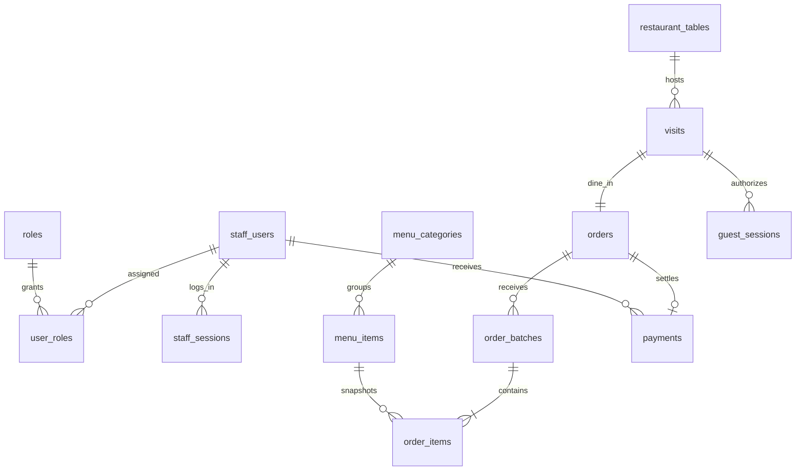

# Cơ sở dữ liệu hiện hành

03/11/2026 · PostgreSQL 16 · **15 bảng ứng dụng + 1 bảng lịch sử EF Core** · schema sau migration004.

Đọc từ tổng quan ở đây, sau đó mở file riêng của từng bảng. Tài liệu mô tả **mã và schema đã triển khai**, không coi thiết kế dự kiến là ràng buộc DB đã có. [ADR-0003](../../ADR/0003-database.md) giải thích cấu trúc; [SSOT](../../SSOT/README.md) giữ quy tắc nghiệp vụ; [hướng dẫn migration](../../GUIDE/DATABASE-MIGRATIONS.md) giải thích vận hành.

## Danh mục từng bảng

| Nhóm       | Bảng                                                | Vai trò                              |
| ---------- | --------------------------------------------------- | ------------------------------------ |
| Tài khoản  | [staff_users](staff_users.md)                       | Danh tính, mật khẩu hash, trạng thái |
| Tài khoản  | [roles](roles.md)                                   | Năm role nội bộ                      |
| Tài khoản  | [user_roles](user_roles.md)                         | Một nhân viên có nhiều role          |
| Tài khoản  | [staff_sessions](staff_sessions.md)                 | Phiên nhân viên có thể thu hồi       |
| Thực đơn   | [menu_categories](menu_categories.md)               | Nhóm và thứ tự menu                  |
| Thực đơn   | [menu_items](menu_items.md)                         | Món, giá hiện tại, còn/hết           |
| Bàn/khách  | [restaurant_tables](restaurant_tables.md)           | Bàn vật lý và QR cố định             |
| Bàn/khách  | [visits](visits.md)                                 | Từng lượt khách ở bàn                |
| Bàn/khách  | [guest_sessions](guest_sessions.md)                 | Quyền khách theo đúng lượt           |
| Đặt món    | [orders](orders.md)                                 | Đơn tại bàn hoặc mang về             |
| Đặt món    | [order_batches](order_batches.md)                   | Đợt gửi và quyết định phê duyệt      |
| Đặt món    | [order_items](order_items.md)                       | Dòng món, snapshot và tiến độ        |
| Thanh toán | [payments](payments.md)                             | Tiền, thời điểm và người nhận        |
| Hạ tầng    | [audit_events](audit_events.md)                     | Nhật ký trước/sau, actor, lý do      |
| Hạ tầng    | [idempotency_records](idempotency_records.md)       | Chống lặp command và replay response |
| EF Core    | [\_\_EFMigrationsHistory](__EFMigrationsHistory.md) | Migration đã áp dụng                 |

Mỗi file trình bày vai trò → từng trường/kiểu/NULL/DEFAULT → PK/FK/CHECK → index → trigger → vòng đời/giới hạn. [TRIGGERS.md](TRIGGERS.md) chứa phần thân SQL hiện hành và giải thích từng hàm.

## Quan hệ chính

ERD lược bớt các FK actor/người duyệt để dễ đọc; danh sách FK đầy đủ nằm trong từng file. Mỗi visit có một order nhờ UNIQUE + deferred integrity; takeaway là order không visit. Mỗi batch có 1–50 items tại commit; mỗi order PAID phải có đúng một payment bằng tổng chốt.

## Quy ước cần hiểu đúng

- `DEFAULT tại DB` và giá trị C# khởi tạo là hai khái niệm khác nhau. Ví dụ `payments.paid_at` không có DEFAULT SQL; server cấp thời điểm. Boolean active có mặc định tại entity, không có DEFAULT SQL.
- `timestamptz` lưu một thời điểm; PostgreSQL không giữ tên múi giờ gốc. Backend thường gửi UTC, màn hình lịch sử dùng UTC+07:00. `now()` là đầu transaction, không có nghĩa DB lưu nhãn UTC.
- Tiền dùng VND nguyên `bigint`, giới hạn 10^12. Không lưu `line_total`, tổng tạm hoặc tiền thừa trùng dữ liệu có thể tính được.
- Bảng Mutable có `id`, `created_at`, `updated_at`, `version`; trigger chỉ kiểm version tăng đúng 1, không tự gán thời điểm. Những bảng khác không tự có nhóm cột này.
- FK dùng `RESTRICT`, không cascade xóa dữ liệu. Không có API hard-delete lịch sử. Ràng buộc SQL không thay cho authorization ở backend; quyền role, mật khẩu và nhiều validation vẫn ở service.
- File `schema.sql` là **đầu vào migration001**, không phải schema cuối cùng để chạy lại. Schema hiện hành là kết quả toàn bộ chuỗi migration, có 3 cột join-code đã bị migration003 loại bỏ và 2 snapshot payment được migration004 thêm.

## Chuỗi migration thực tế

| Thứ tự | Migration ID / file                                                                                                                 | Thay đổi                                                                                                    |
| ------ | ----------------------------------------------------------------------------------------------------------------------------------- | ----------------------------------------------------------------------------------------------------------- |
| 001    | `202611020001_InitialSchema` · [InitialMigration.cs](../../Backend/Restaurant.Api/Data/InitialMigration.cs)                         | Đọc SQL nhúng [schema.sql](../../Backend/Restaurant.Api/Data/schema.sql), tạo 15 bảng, index và trigger nền |
| 002    | `202611020002_IntegrityGuards` · [IntegrityMigration.cs](../../Backend/Restaurant.Api/Data/IntegrityMigration.cs)                   | DEFAULT timestamp/version, CHECK bổ sung, guard order/batch/table/visit, index FK                           |
| 003    | `202611020003_FixedTableQr` · [FixedTableQrMigration.cs](../../Backend/Restaurant.Api/Data/FixedTableQrMigration.cs)                | Ciphertext QR cố định, thay guard_visit, bỏ join-code/generation                                            |
| 004    | `202611030004_PaymentRecipientHistory` · [PaymentHistoryMigration.cs](../../Backend/Restaurant.Api/Data/PaymentHistoryMigration.cs) | Snapshot người thu, kiểm INSERT, index lịch sử, giữ dòng/đợt PAID                                           |

Đây là EF Core SQL-first migration, mỗi class có `Up()`/`Down()`, không dùng bộ file `migration_vN_up.sql`/`migration_vN_down.sql` độc lập. **Down hiện throw, không hỗ trợ rollback tự động**. Không sửa bản đã chạy để nâng database; phải thêm migration mới. Không có EF ModelSnapshot/design-time scaffolding trong bản hiện tại. Chi tiết và giới hạn tại [GUIDE](../../GUIDE/DATABASE-MIGRATIONS.md).

## Quy trình đồng bộ bắt buộc

1. Xác định yêu cầu đổi và cập nhật đúng file SSOT; quyết định thiết kế thay đổi thì sửa/thêm ADR. Không coi code lệch đặc tả tự động là yêu cầu mới.
2. Nếu đổi schema, thêm migration kế tiếp; cập nhật entity/mapping/service. Không sửa migration đã áp dụng hoặc tự chạy SQL sửa production.
3. Chỉ trên database phát triển được chỉ định và đã nâng cấp có chủ đích, export **schema metadata** bằng `python scripts/export_db_metadata.py`. Script chỉ dùng transaction READ ONLY, đọc catalog và MigrationId; không chạy migration, seed, query tài khoản/đơn, hoặc xóa dữ liệu. Nó cố định Compose project `restaurant_ordering`, service `postgres`; không truy cập project khác.
4. Review metadata; sửa giải thích trong `scripts/db_doc_catalog.py`, ADR-0003/0004 và các ADR/SSOT/API bị ảnh hưởng. Kiểu/NULL/DEFAULT/constraints/index/trigger được lấy từ metadata, ý nghĩa nghiệp vụ vẫn cần người review.
5. Chạy `python scripts/generate_db_docs.py` rồi `python scripts/generate_db_docs.py --check`. Check chạy offline: so nội dung tài liệu, đủ tên bảng/trường, chuỗi migration và fingerprint nguồn backend. Thay đổi backend làm manifest cũ bị báo lệch, buộc review lại. Không chỉ sinh lại để bỏ qua cảnh báo.
6. Kiểm tra diff và commit cả migration/code/SSOT/ADR/docs cùng thay đổi. Không tự push. Đây là điều kiện hoàn tất công việc, được ghi ở [AGENTS.md](../../AGENTS.md).

`schema-metadata.json` chỉ chứa cấu trúc catalog và tên migration, không chứa bản ghi kinh doanh hay secrets. `source-manifest.json` giúp phát hiện nguồn backend đổi sau lần review; không chứng minh phần giải thích nghiệp vụ đúng về ngữ nghĩa. Check offline cũng không phát hiện DDL sửa tay ngoài code; export lại metadata trên đúng môi trường khi cần đối chiếu. Hiện chưa có CI tự chạy check này, vì vậy developer phải chạy trước commit.

## Giới hạn và nguồn chuẩn

Migration + SQL trong code là nguồn thực thi schema; `docs/db` là từ điển giải thích hiện trạng; ADR là lý do/cách thiết kế; SSOT là nguồn duy nhất của quy tắc feature. Không duy trì thêm một DDL hiện hành để chạy song song với migrations. Quy tắc mong muốn chưa implement phải ghi backlog riêng, không mô tả như trigger/CHECK đã tồn tại.
